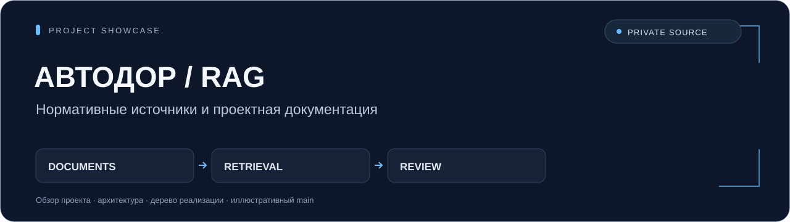

# Автодор · RAG для проектной документации

**Поиск нормативных оснований и конвейер проверки документов с управлением проектами и результатами.**

Python · FastAPI · PostgreSQL / pgvector · Vue 3 · React · OCR · RAG



[Архитектура](docs/ARCHITECTURE.md) · [Полное дерево приватной реализации](docs/SOURCE_TREE.md) · [Иллюстративный main](examples/main.py)

Это публичная портфолио-витрина одной из реализаций семейства Автодор. Она описывает инженерную работу и структуру проекта; исходный код реализации хранится в приватном репозитории. Детали рабочего контура не разглашаются.

## Задача проекта

Нормативная библиотека и проектные документы различаются по формату, объёму и структуре. Для анализа нужно извлечь содержимое, найти применимые фрагменты и сохранить основания вместе с результатом проверки.

Архитектурный акцент этой реализации — связка обработки документов, нормативного retrieval и интерфейса проектов: источники и пресеты задают контекст проверки, а очередь и события прогресса сопровождают длительные операции.

## Компоненты приватной реализации

| Область | Назначение |
| --- | --- |
| API и организация данных | Проекты, проектные файлы, нормативные источники, пресеты и результаты проверки. |
| Извлечение содержимого | PDF, DOCX, RTF, текст и изображения; OCR сканов и визуальный анализ чертежей. |
| Индексация и retrieval | Семантическое разбиение, embeddings, pgvector и метаданные нормативных источников. |
| Проверка и отчёт | Быстрый режим с retrieval и подробный по выбранным источникам; сохранение результатов и Markdown-экспорт. |
| Веб-клиенты и интеграции | Vue-клиент с SSE, альтернативный React-клиент, отдельный сервис embeddings и опциональная аутентификация. |

## Путь документа

Нормативные источники → извлечение и индексация; проектный документ → извлечение → поиск фрагментов или выбранные источники → модельный анализ → сохранение результата и отчёт.

Это схема обязанностей компонентов. Подробный обзор связей приведён в [архитектуре](docs/ARCHITECTURE.md); внутренние алгоритмы, правила и промпты в витрину не входят.

## Навигация по исходной структуре

| Область | Назначение |
| --- | --- |
| `backend/app/routers/` | API проектов, файлов, источников, пресетов, проверок и результатов. |
| `backend/app/services/` | Обработка входных форматов, индексация, retrieval, проверки и результаты. |
| `frontend-danilisssimo/` | Основной Vue-клиент рассматриваемой реализации. |
| `frontend/` | Альтернативный React-клиент. |
| `st1_embedding_server/` | Отдельный компонент embeddings. |
| `universal_auth/ и translations/` | Опциональная аутентификация и локализация. |

Пути в этой таблице относятся к приватной реализации. Полный список 256 отслеживаемых файлов представлен только в виде дерева имён в [SOURCE_TREE](docs/SOURCE_TREE.md).

## Безопасный пример

Нужен Python 3; сторонних зависимостей нет:

```sh
python examples/main.py
```

Пример печатает фиксированное синтетическое описание стадий. Он не читает документы, не обращается к сети, модели или базе и не выполняет реальную проверку документации. Это иллюстрация структуры, а не открытая часть закрытого алгоритма.

## Граница раскрытия

В публичную витрину входят описание, схема архитектуры, дерево относительных путей и синтетический пример. Реализация, зависимости, схемы, промпты, конфигурации, Docker-файлы, тестовые фикстуры, рабочие документы, нормативные библиотеки, отчёты, адреса сервисов и учётные данные остаются приватными.

Описание основано на проверенном README и списке файлов приватной копии. Оно не подтверждает доступность закрытых интеграций, качество модели на рабочих данных или готовность к эксплуатации. Результаты реальной проверки документации требуют экспертного рассмотрения.
