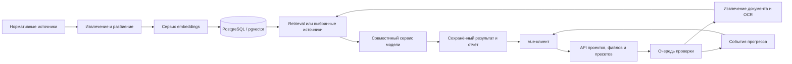

# Архитектура · Автодор · RAG для проектной документации

[К обзору проекта](../README.md) · [Дерево приватных исходников](SOURCE_TREE.md)

Архитектурный акцент этой реализации — связка обработки документов, нормативного retrieval и интерфейса проектов: источники и пресеты задают контекст проверки, а очередь и события прогресса сопровождают длительные операции.

## Связи компонентов

Диаграмма показывает концептуальные обязанности и потоки данных. Она не раскрывает внутренние контракты, последовательность конкретных вызовов, промпты, параметры или конфигурацию закрытого окружения.

## Архитектурные акценты

### Два входных потока

Нормативные источники подготавливаются для поиска, а проектный документ проходит собственное извлечение. Эти обязанности разделены концептуально.

### Контекст проверки

В описанной реализации есть быстрый режим с retrieval и подробный режим по выбранным источникам. Пресеты определяют выбор источников; внутренние параметры не раскрываются.

### Прослеживаемость источников

Компоненты метаданных учитывают идентификаторы, редакции, состояния и хеши. Рабочая библиотека и конкретные нормативные материалы не публикуются.

### Длительные операции

Очередь и SSE связывают выполнение проверки с интерфейсом прогресса. Публичная витрина эти операции не выполняет.

### Варианты клиентов

Основной клиент — Vue, в приватном дереве также есть альтернативный React-клиент. Их наличие не означает одинаковую полноту сценариев или подтверждённое подключение к рабочим сервисам.

## Граница публичного примера

`examples/main.py` содержит собственные синтетические подписи стадий и выводит статическую информацию. Он не импортирует приватные модули и не реализует извлечение, retrieval, модельный анализ или проверку результатов.

Рабочие материалы и детали закрытого контура не разглашаются. Наличие компонента в дереве исходников не подтверждает успешный runtime-прогон или производственную готовность.
